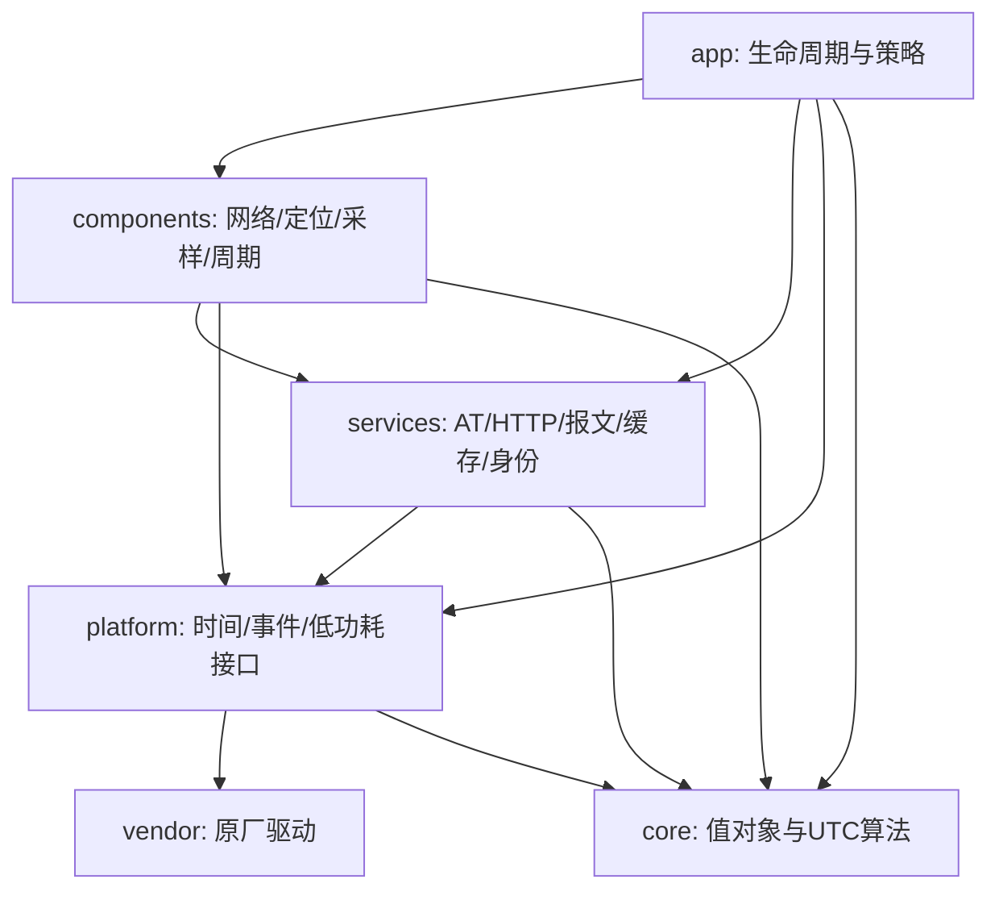
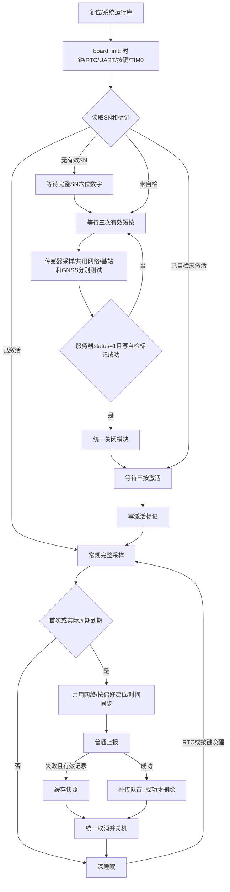

# 新工程运行说明

## 模块依赖

业务状态、配置和当前记录归APP；网络历史归network_manager；GNSS/基站定位只发布Position；采样只发布TelemetryRecord中的传感器字段；AT响应归at_client；HTTP请求与响应归http_service；缓存按值存储，消费者只借用队首直到成功删除。没有extern可变业务全局变量。

## 生命周期

SN布局保持0xEE00四字节小端，最后第4字节作为提交判据；自检+30=0x55，激活+40=0x44。不自动擦除已有身份。空白设备的UART已初始化，接收整行SN=123456及CRLF；非法或超长行拒绝。

自检不调用正常周期决策，服务器拒绝后允许重新三按。普通运行首次就尝试上报，此后运动/静止周期按实际单调毫秒差判断。当前实现每次唤醒同时取ADC和运动快照，首轮普通运行也取运动样本；这是相对旧“先决策后按需ADC、首轮跳过运动”的明确调整。

## 时间与异步步骤

AT、HTTP、网络上电等待、搜网、GNSS等待及关机等待均通过poll推进。APP每轮先at_poll，再处理按键和业务阶段。TIM0只累计约11.573ms节拍对应的真实毫秒余数，UART IRQ只搬字节，RTC/按键IRQ只清标志并发布唤醒位。

ADC稳定110ms加转换最长100ms为同步例外；一个I2C寄存器事务20ms，6字节XYZ读至多6个事务。采样阶段没有在途AT，因此不会为了传感器采样停顿正在等待的HTTP接收。运动使用50点在线方差，不保存600字节样本数组。

所有超时必须在TIM0能推进的前台使用。深睡停TIM0，以RTC秒差补偿，不用NTP墙上时间跳变判定通信超时。睡眠入口受临界区和实际按键电平保护；唤醒返回调用点后恢复UART/时基并重新采样。

## 失败与资源释放

| 故障 | 处理 |
|---|---|
| AT超时/ERROR/溢出 | 结束事务，静默排空250ms；持续噪声最多排空2s |
| GNSS四次失败 | 尝试关闭AGPS/GPS；按策略回退基站或返回失败 |
| 两种定位均失败 | 不发送伪造0坐标普通记录，关机并等待后续周期 |
| HTTP失败 | 完整有效快照缓存，不锁死首轮 |
| 配置缺失/非法 | 不更新配置，不重复入队已完成HTTP确认的记录 |
| 补传失败 | 保留原队首及顺序，下一轮再尝试 |
| APP非法状态 | 标记INVALID，取消各流程并按身份回到合法入口 |
| 关机 | 取消采样/定位/HTTP/上报状态，保留缓存，执行原PWRKEY序列再断电 |
| HardFault | 系统复位；不声称已实现持久故障记录与重复故障抑制 |

application_snapshot是前台只读诊断入口，包含状态、最近失败、是否自检和缓存条数；不允许通过它修改内部状态。测试读取其接口不会替代实板日志和测量。

## 仍需产品/硬件确认

原服务器字段和URL保持兼容，温度字段仍为原电阻推导值，未引入未经证实的摄氏度转换。真实模块的QHTTPREAD终结行、NTP时区单位、GNSS/基站响应格式、Flash断电提交、低功耗与电气时序见迁移文档及验证记录。当前没有固件升级、看门狗健康监控、持久化定位缓存或远程改SN功能，不应据重构目录推断这些功能存在。
